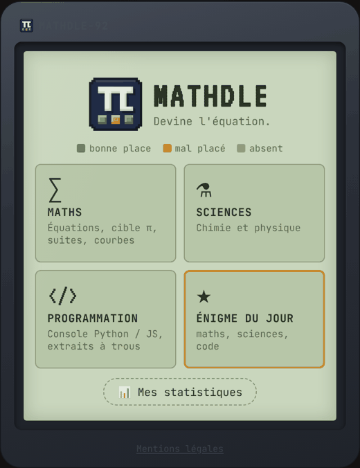
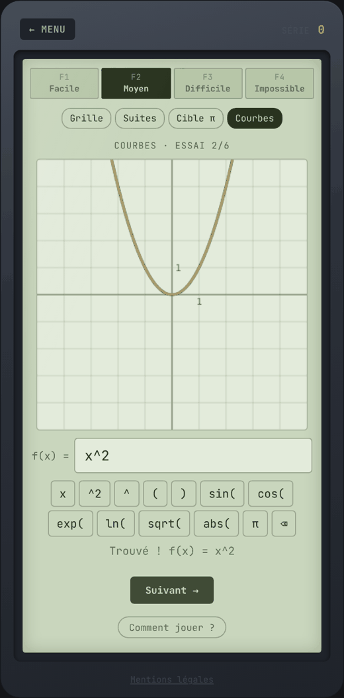
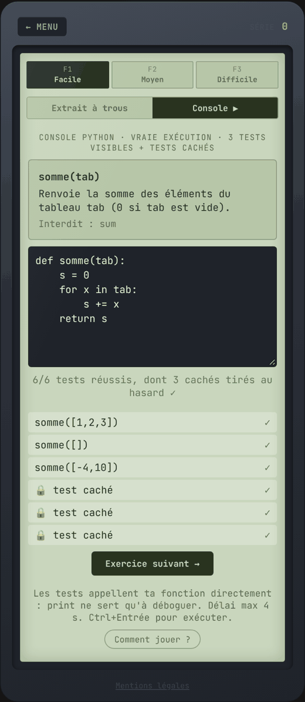
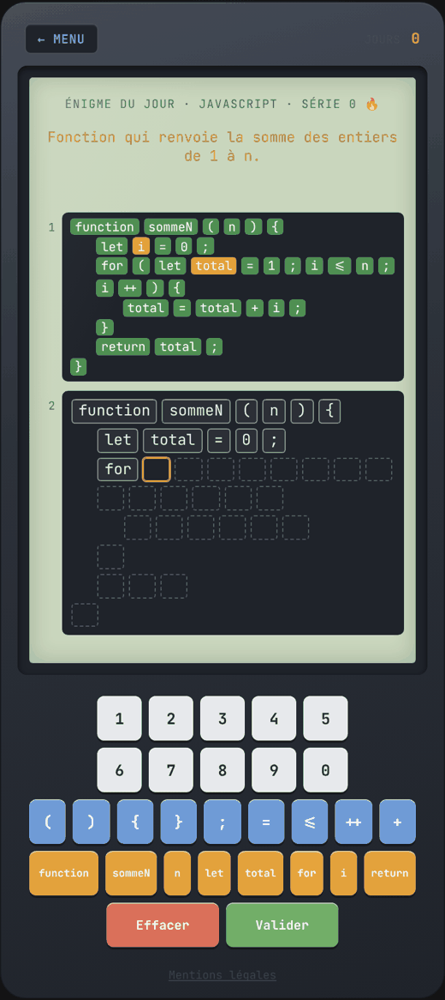
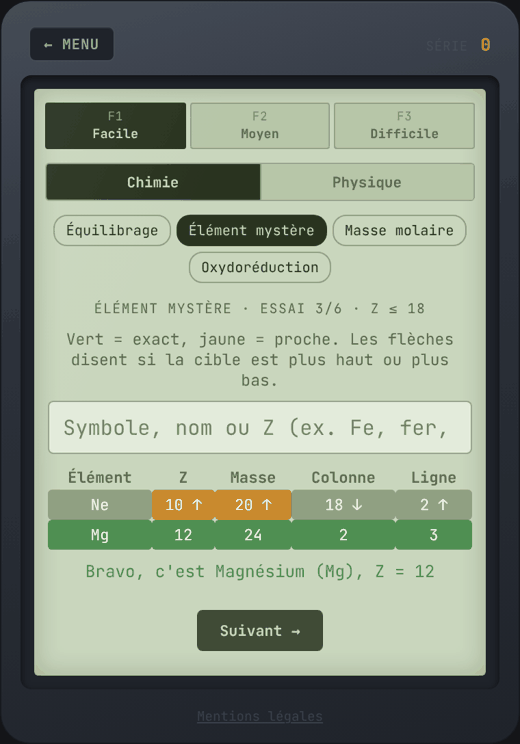
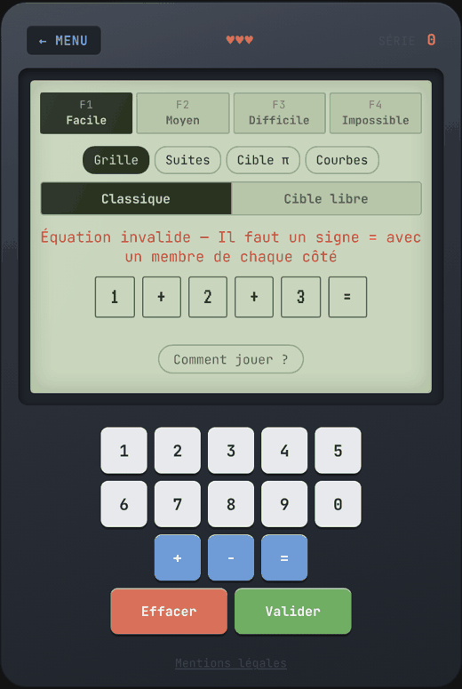

<div align="center">


# Mathdle

**Le Wordle des maths, des sciences et du code, dans une calculatrice graphique.**

Devine l'équation du jour, trace la bonne courbe, retrouve un élément du tableau périodique
ou écris une vraie fonction Python qui passe des tests cachés.

[](https://mathdlee.vercel.app)

[](https://github.com/alnrfLO/mathdle/actions/workflows/ci.yml)
[](https://github.com/alnrfLO/mathdle/releases)


[](LICENSE)

</div>

<p align="center">
  
  
  
  
</p>

---

## Sommaire

- [Les jeux](#les-jeux)
- [Énigme du jour, stats et partage](#énigme-du-jour-stats-et-partage)
- [Installer sur téléphone](#installer-sur-téléphone)
- [Comment ça marche](#comment-ça-marche)
- [Lancer le projet](#lancer-le-projet)
- [Structure](#structure)
- [Crédits](#crédits)

## Les jeux

### ∑ Maths

| Mode | Principe |
| --- | --- |
| **Grille** | Devine l'équation secrète, retour case par case façon Wordle. 4 niveaux, jusqu'à **Impossible** (limites, intégrales, dérivées). |
| **Cible libre** | Construis une expression qui tombe pile sur un nombre, avec un nombre de caractères imposé. |
| **Cible π** | Vise une valeur comme `3π/4` : `6π/8`, `π/2 + π/4`… tout ce qui est égal est accepté. |
| **Suites** | Trouve le terme suivant : arithmétique, géométrique, Fibonacci, carrés, arithmético-géométrique… |
| **Courbes** | Une courbe s'affiche, tape `f(x)` et ta courbe se superpose. Des droites jusqu'à `x·sin(x)`. |

### ⚗ Sciences

| Domaine | Mode | Principe |
| --- | --- | --- |
| Chimie | **Équilibrage** | 60 réactions, les atomes sont vraiment comptés |
| Chimie | **Élément mystère** | Le Wordle du tableau périodique (Z, masse, colonne, ligne) |
| Chimie | **Masse molaire** | De `H₂O` à `CuSO₄·5H₂O` |
| Chimie | **Oxydoréduction** | Demi-équations en milieu acide |
| Physique | **Formules** | 55 formules à deviner case par case |
| Physique | **Conversions** | Générées à l'infini |
| Physique | **Unités** | De `N` à `kg·m²/s³` |
| Physique | **Applications numériques** | La valeur **et** l'unité |
| Physique | **Conversions en chaîne** | `km/h → m/s`, `mL → m³`, `kWh → J` |

<p align="center">
  
  
</p>

### `</>` Programmation

- **Console Python / JavaScript** : on écrit une vraie fonction, **exécutée dans le navigateur**.
  - 13 exercices inspirés des épreuves pratiques de NSI (somme, maximum, palindrome, fusion de listes triées…).
  - Tests visibles **et tests cachés tirés au hasard** à chaque exécution : renvoyer les réponses en dur ne passe pas.
  - Vérification du nom et des paramètres, fonctions toutes faites interdites (`sum`, `max`, `sorted`…), arrêt après 4 s si boucle infinie.
- **Extrait à trous** et **Page blanche** (Java, C++) : 72 exercices dans 4 langages, affichés comme du vrai code, indentation comprise.

## Énigme du jour, stats et partage

- Une énigme par jour en **maths**, **sciences** et **code** (4 langages), **la même pour tout le monde**.
- **Série de jours** : elle continue seulement si tu as réussi la veille.
- **Statistiques** par mode : parties jouées, % de réussite, série en cours et record.
- **Partage** façon Wordle, sans spoiler :

```
Mathdle Maths 2026-11-26 3/6
🟨⬛⬛🟨🟨🟩
🟩🟨⬛🟩🟩🟩
🟩🟩🟩🟩🟩🟩
mathdlee.vercel.app
```

Aucun compte, aucun cookie de suivi : tout reste dans le navigateur.

## Installer sur téléphone

Mathdle est une **PWA** : elle s'installe comme une appli et marche hors ligne après la première visite.

- **iPhone** : ouvre [mathdlee.vercel.app](https://mathdlee.vercel.app) dans Safari → **Partager** → **Sur l'écran d'accueil**.
- **Android** : menu de Chrome → **Installer l'application**.

## Comment ça marche

- **Aucun `eval`.** Les expressions (Cible π, Courbes) passent par un petit analyseur maison (`src/lab/expr.ts`) avec multiplication implicite (`2x`, `3π`, `x(x+1)`).
- **Courbes comparées point par point** : 200 points d'échantillonnage, donc `2(x+1)` et `2x+2` sont la même réponse.
- **Code isolé dans un Web Worker** créé à la volée, avec délai maximum. Python tourne grâce à [Pyodide](https://pyodide.org) (CPython compilé en WebAssembly), chargé seulement au premier usage.
- **Résultats attendus calculés par une solution de référence**, ce qui permet de générer des tests cachés différents à chaque essai.
- **Énigme du jour déterministe** : générateur pseudo-aléatoire (mulberry32) initialisé avec la date.
- **Mise en forme du code** déduite des tokens (accolades pour JS/Java/C++, blocs `:` pour Python), vérifiée sur les 72 exercices.

## Lancer le projet

```bash
git clone https://github.com/alnrfLO/mathdle.git
cd mathdle
npm install
npm run dev      # serveur de développement
npm run build    # build de production (dist/)
npm run lint     # oxlint
npm test         # tests unitaires (Vitest) puis de bout en bout (Playwright)
```

Les tests de bout en bout jouent chaque mode dans un vrai navigateur, comme un joueur :
victoires, défaites, anti-triche de la console, série de jours, partage. Ils tournent à chaque push
grâce à GitHub Actions.

Node 20 ou plus récent.

## Structure

```
src/
├── game/          logique des maths (parser, moteur, générateur, banque de programmation)
├── science/       chimie (équilibrage), physique (formules), conversions
├── lab/           modes v2 : suites, cible π, courbes, élément, masse molaire,
│                  oxydoréduction, unités, applications numériques, console, stats
├── hooks/         état React par mode de jeu
├── components/    affichage (calculatrice, grilles, menus)
└── App.tsx        navigation et clavier physique
tests/
├── unit/          Vitest : évaluateur, chimie, mise en forme du code, exercices
└── e2e/           Playwright : chaque mode joué de bout en bout
public/
├── manifest.webmanifest, sw.js   PWA
└── logo-512.png, og-image.png    identité visuelle
```

## Crédits

- **Logo** : [Sylvain Belevindiran](https://portfolio-sylvain-belevindiran.vercel.app)
- **Python dans le navigateur** : [Pyodide](https://pyodide.org) (MPL 2.0)
- **Polices** : JetBrains Mono et VT323 via [Fontsource](https://fontsource.org)

## Auteur

**Rafael Antunes Oliveira**, étudiant en BUT MMI (développement web) à l'IUT de Bobigny.

[](https://rafatns.vercel.app)
[](https://linkedin.com/in/rafatns)
[](https://github.com/alnrfLO)

<sub>Projet personnel à but pédagogique : fait pour s'entraîner, pas pour tricher en cours.</sub>
